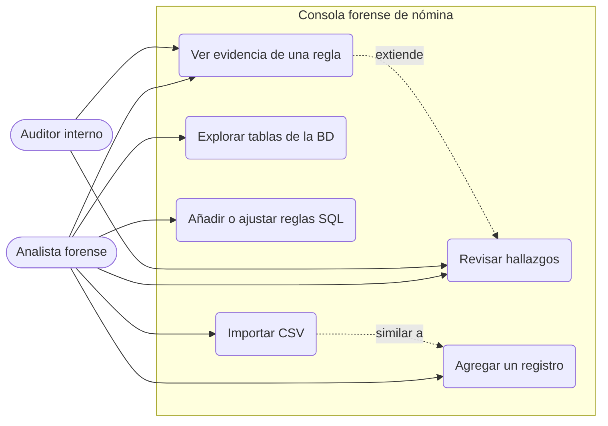
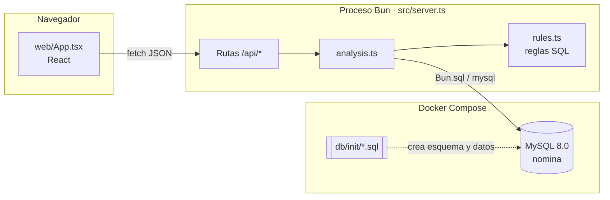
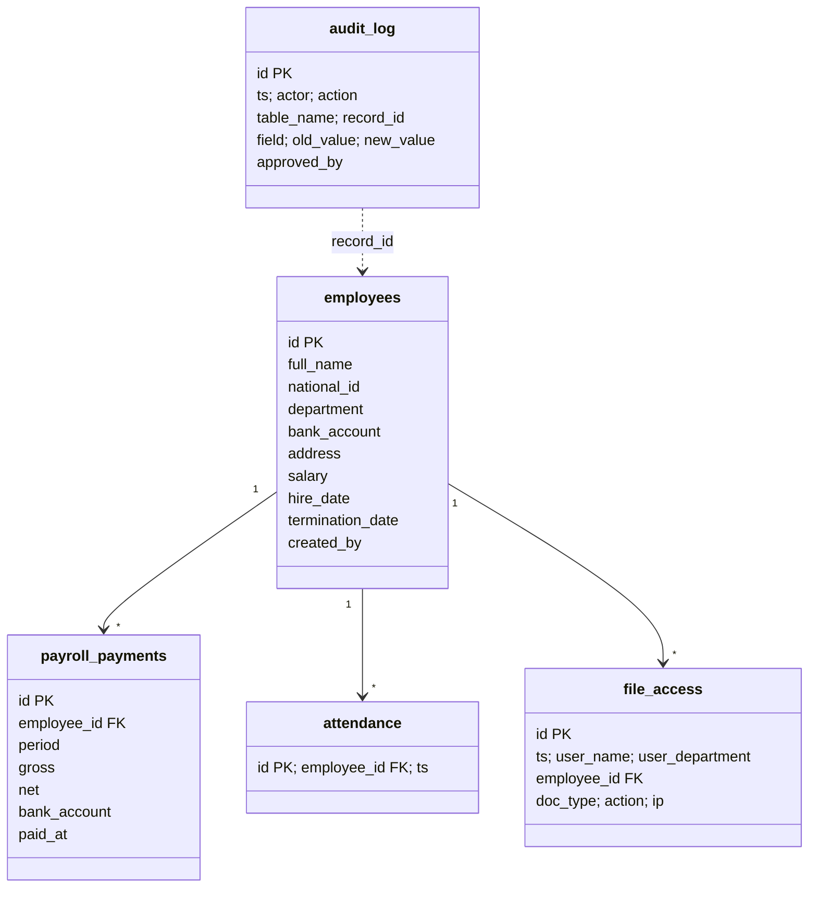
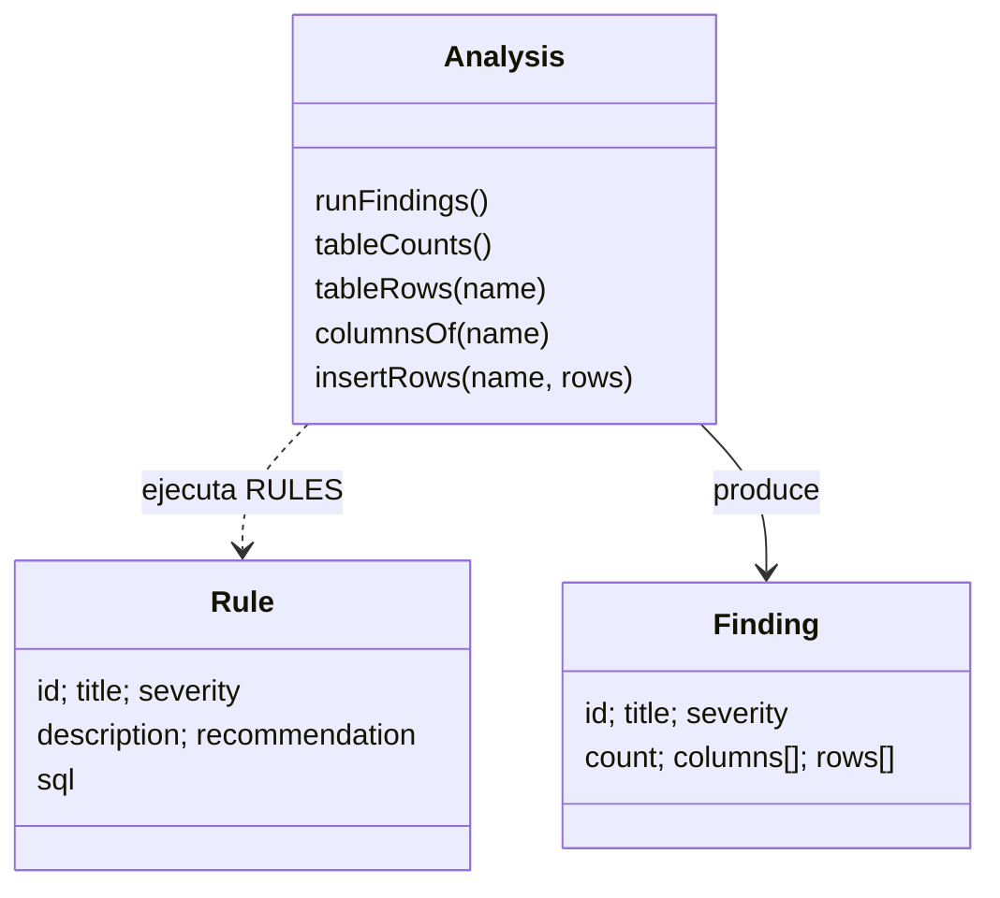
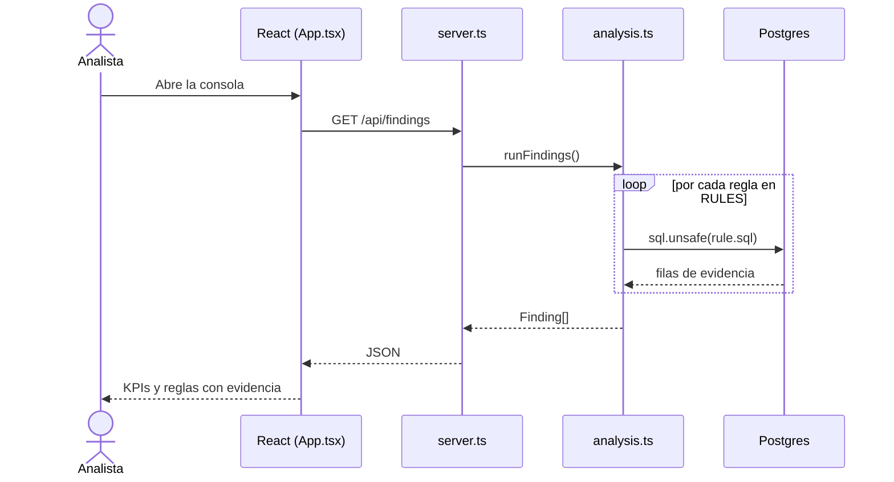
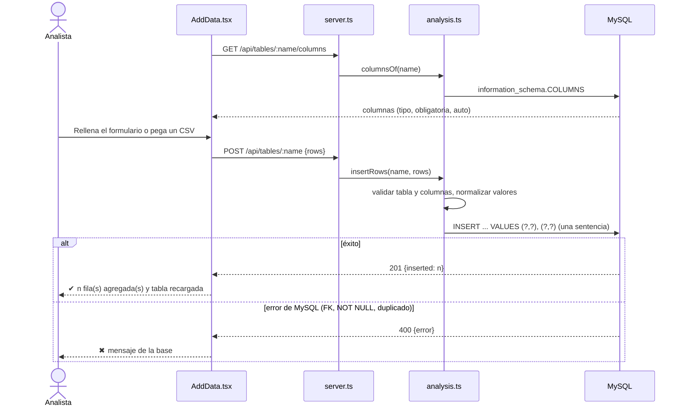
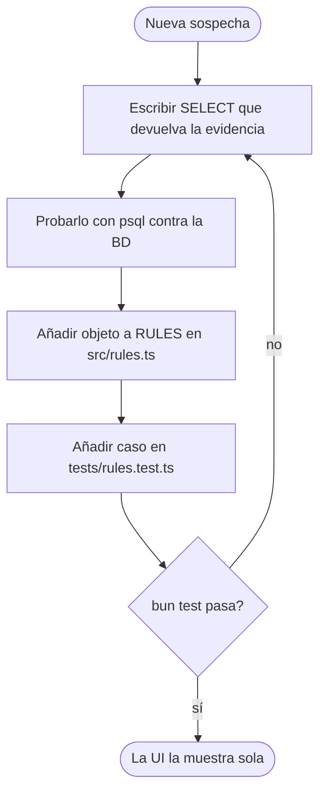

# Diagramas UML (genéricos)

Mermaid: se ve en GitHub/GitLab, VS Code (Markdown Preview Mermaid) o <https://mermaid.live>. Ajústalos leyendo `db/init/01-schema.sql`, `src/rules.ts` y `web/App.tsx`.

## 1. Casos de uso

## 2. Componentes / despliegue

## 3. Modelo de datos (clases / ER)

## 4. Clases de la aplicación

## 5. Secuencia: cargar hallazgos

## 6. Secuencia: agregar datos (formulario o CSV)

## 7. Actividad: añadir una regla

